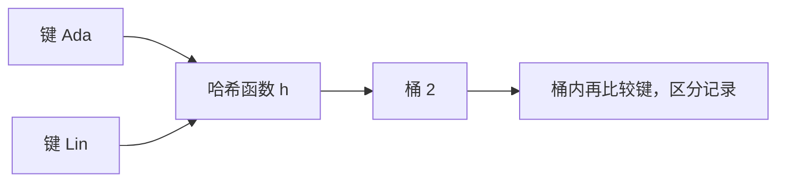
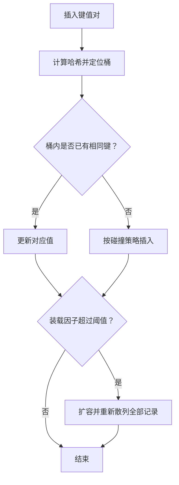

# 哈希表

> 本篇早期笔记已扩展整理到[算法刷题系列第二篇：哈希表——用空间换查找](/posts/2022/01/25/algorithm-practice-hash-table/)，包括冲突处理、频次统计、两数之和与复杂度分析。

## 1. 哈希表解决什么问题？

给定一组记录，如果每次查询都从头比较，查找一个键需要 `O(n)` 时间。哈希表通过哈希函数把键映射到数组下标，让插入、查找和删除在平均情况下接近 `O(1)`。

例如通讯录可以把姓名作为键、电话号码作为值：

```text
"Ada"  -> "555-0101"
"Lin"  -> "555-0132"
```

哈希表的核心不是“算出一个绝不会重复的地址”，而是快速定位候选位置，并在发生碰撞时仍能正确区分不同键。

## 2. 哈希函数与碰撞

哈希函数 `h(key)` 将任意键映射到有限范围的桶编号。若数组容量为 `m`，常见做法是将哈希值映射到 `[0, m)`。

不同键可能得到相同桶编号，这叫**哈希碰撞**。例如 `h("Ada") = 2` 且 `h("Lin") = 2`。碰撞不是异常，而是有限地址空间中的必然可能；数据结构必须明确处理它。



## 3. 两种常见碰撞处理方式

### 链地址法

每个桶保存一个小集合，所有映射到同一桶的记录放入该集合。查找时先定位桶，再在桶中比较键。

```text
桶 0: []
桶 1: [("Mia", 21)]
桶 2: [("Ada", 18), ("Lin", 20)]
桶 3: []
```

优点是实现直观，删除方便；缺点是每个记录要有额外链接或集合管理开销。若哈希函数均匀，桶中平均元素数较少。

### 开放寻址法

所有记录都直接放在数组里。目标位置已被占用时，按照探测序列继续寻找空位。线性探测是最简单的方案：

```text
index(key, i) = (h(key) + i) mod m
```

查找时必须沿同一序列探测，直到找到键或遇到从未使用过的空槽。删除不能简单清空槽位，否则可能截断后续键的探测路径；通常使用“已删除”标记，或重新整理簇中的元素。

## 4. 装载因子与扩容

装载因子衡量表的拥挤程度：

```text
alpha = 已存元素数 / 桶数
```

装载因子过高会增加碰撞和探测长度。实现通常在达到阈值时扩容，并把已有记录按新容量重新散列；不能只把旧数组复制到新数组，因为桶编号依赖容量变化。



## 5. 操作成本与正确性约束

|操作|平均情况|最坏情况|
|---|---:|---:|
|查找|`O(1)`|`O(n)`|
|插入|`O(1)` 摊还|`O(n)`|
|删除|`O(1)` 平均|`O(n)`|

平均复杂度依赖哈希分布和装载因子；如果大量键落在同一桶，链地址法可能退化为线性查找。扩容会让单次插入耗时 `O(n)`，但把多次插入的总成本平均后，通常仍可得到摊还常数级插入。

实现键比较时要遵守一致性：两个键若相等，必须得到相同哈希值；哈希值相同并不代表键相等。键加入哈希表后若其参与哈希计算的字段发生变化，可能导致记录再也无法通过原键找到。

## 6. 什么时候使用哈希表？

- 需要按键快速查找、更新或去重。
- 需要统计频次，或判断元素是否出现过。
- 需要把一组键映射到附加信息。
- 需要在算法中记录“已访问状态”。

若需要按键排序、范围查询或稳定的顺序遍历，应考虑搜索树或排序数组，而不是仅凭平均查找速度选择哈希表。

## 小结

哈希表把键映射到桶，再通过碰撞处理保证正确性。理解哈希函数、碰撞方案、装载因子和扩容机制，才能知道平均 `O(1)` 的前提以及最坏情况下的边界。
