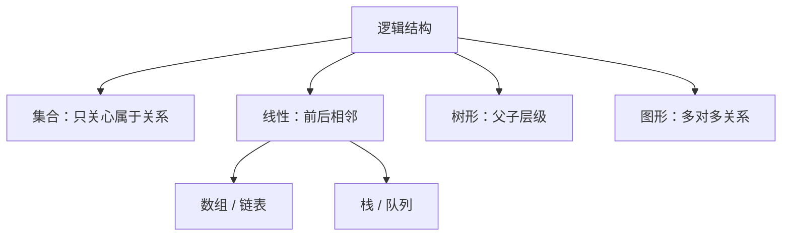
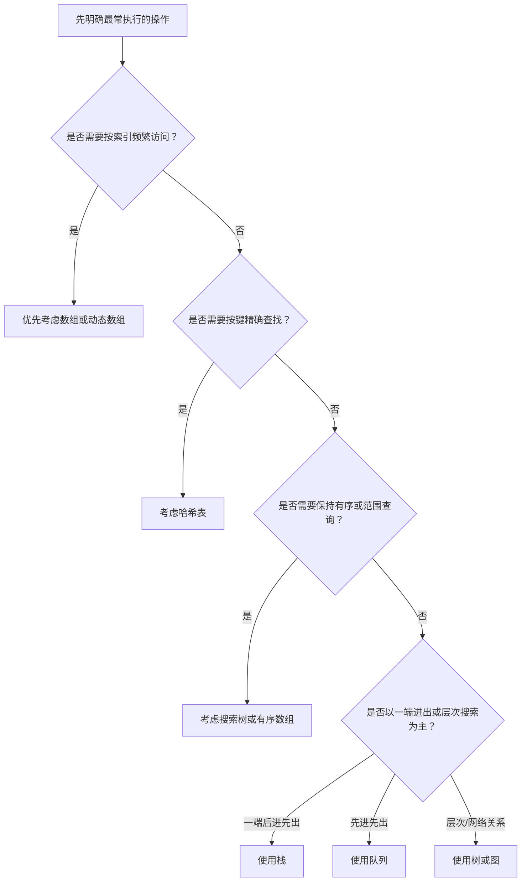

# 数据结构

> 本篇中的逻辑结构、存储结构和操作成本已整理扩展到[算法刷题系列第五十七篇：算法复杂度与数据结构](/posts/2024/01/10/algorithm-practice-complexity-and-data-structures/)；线性表的实现取舍见[第五十八篇](/posts/2024/01/25/algorithm-practice-linear-list-array-linked-list/)。

数据结构研究的是如何组织数据，以及如何在这种组织方式上高效地执行操作。选择结构时要分清两个层次：数据在逻辑上是什么关系，以及这种关系如何在内存或存储设备中实现。

## 1. 从数据项到数据结构

- **数据项**是不可再分或在当前问题中作为整体处理的字段，例如学生记录中的学号。
- **数据元素**是参与处理的基本对象，例如一条完整的学生记录。
- **数据对象**是具有相同性质的数据元素集合，例如所有学生记录。
- **数据结构**描述数据元素之间的关系、存储方式，以及允许执行的操作。

一个学生表可以视作线性结构；同一批学生也可以按院系组织成树，或按课程选修关系组织成图。数据元素相同，关系模型不同，适合的操作也不同。

## 2. 逻辑结构：元素之间如何关联

常见逻辑结构包括：

|结构|关系特征|例子|
|---|---|---|
|集合|只有成员关系，不强调先后|待处理任务集合|
|线性结构|一个元素通常只有一个直接前驱和后继|数组、链表、栈、队列|
|树形结构|层次关系，一个父节点可有多个子节点|目录树、组织架构|
|图形结构|一般的多对多关系|道路网、社交关系|

栈和队列仍属于线性结构，它们通过限制允许的操作来表达不同规则：栈只在一端进出，队列在一端进入、另一端离开。

## 3. 存储结构：逻辑关系如何落地

### 顺序存储

元素连续存放，通过下标计算位置。优点是按下标访问通常为 `O(1)`、遍历局部性好；中间插入或删除通常要移动后续元素，成本为 `O(n)`。动态数组会通过预留容量减少频繁扩容。

### 链式存储

每个节点保存数据和指向其他节点的引用。节点不必相邻，新增节点时可以通过改引用连接到结构中。若已经持有插入点，修改链接可为 `O(1)`；但按位置查找仍需从头遍历，为 `O(n)`。

### 索引存储

除数据本身外，还维护键到记录位置的辅助索引。索引加快查询，但占用额外空间，并且插入、删除时需要维护索引。

### 散列存储

通过哈希函数把键映射到桶位置，适合按键精确查找。碰撞处理和装载因子会影响性能，不能保证所有情况下都为常数时间。

## 4. 同一逻辑结构可以有不同实现

以线性序列为例：

|操作|动态数组|单链表|
|---|---:|---:|
|按下标读取|`O(1)`|`O(n)`|
|按值查找|`O(n)`|`O(n)`|
|已知位置插入/删除|通常需移动，`O(n)`|改链接可为 `O(1)`|
|连续遍历|缓存局部性较好|需要沿引用逐节点访问|

因此，“链表插入是 `O(1)`”只有在已经定位到相邻节点时成立；若还要按索引寻找插入点，总成本仍是 `O(n)`。

## 5. 如何选择结构

## 小结

逻辑结构描述“关系是什么”，存储结构描述“如何保存关系”。性能取决于目标操作、数据规模和实现细节。先列出最常见的查询、插入、删除和遍历，再比较候选结构的时间与空间成本。
