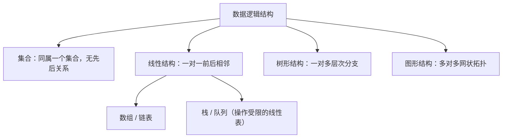
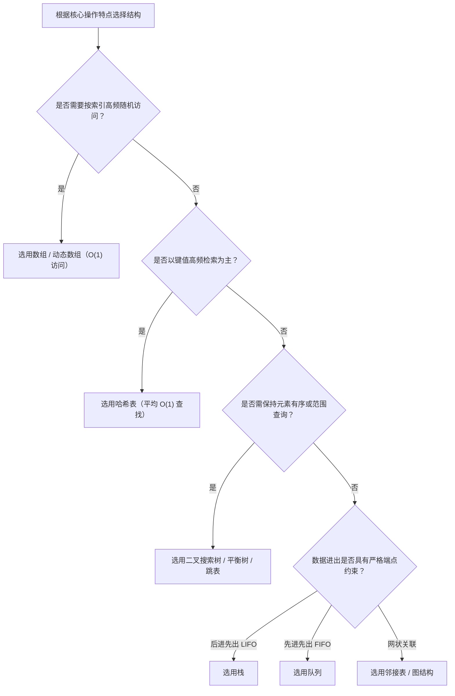

# 数据结构与算法基础

> 本篇中的逻辑结构、存储结构与复杂度度量已整理扩展到[算法刷题系列第五十七篇：算法复杂度与数据结构](/posts/2024/01/10/algorithm-practice-complexity-and-data-structures/)；线性表实现详见[第五十八篇](/posts/2024/01/25/algorithm-practice-linear-list-array-linked-list/)。

数据结构研究的是数据在计算机中的组织、存储与关系表示；算法则是为解决特定问题而规定的一系列确定指令与操作步骤。程序设计的本质即“数据结构 + 算法 = 程序”。

## 1. 从数据项到数据结构

- **数据项**：不可再分的数据最小单位，例如学生记录中的学号。
- **数据元素**：参与处理的基本个体对象，例如一条完整的学生档案记录。
- **数据对象**：性质相同的数据元素集合，例如全校所有学生的档案集合。
- **数据结构**：数据元素之间的关系集合，包含逻辑关系、存储实现以及在其上定义的操作。

同一组数据元素，因关注的关系不同，可构建为完全不同的数据结构：按学号顺序排列可视为线性结构；按院系班级归属可组织为树形结构；按选课关联可组织为图形结构。

## 2. 逻辑结构与存储结构

### 逻辑结构：元素之间的逻辑关系

| 结构类型 | 关系特征 | 典型实例 |
| :--- | :--- | :--- |
| **集合结构** | 元素间仅有“同属于一个集合”的关系，无前后次序 | 唯一任务池、哈希集合 |
| **线性结构** | 元素间存在一对一的先后相邻关系（唯一的直接前驱和后继） | 数组、链表、栈、队列 |
| **树形结构** | 元素间存在一对多的层级隶属关系 | 目录树、组织架构、二叉树 |
| **图形结构** | 元素间存在多对多的网状关系 | 拓扑图、交通路线网、社交网络 |

### 存储结构：物理内存中的实现

1. **顺序存储**：利用物理上连续的存储单元依次存放数据元素（如数组），下标寻址开销为 `O(1)`，但插入或删除往往需要批量平移后续元素。
2. **链式存储**：节点分散存放于不连续的内存单元中，每个节点保存数据项与指向相邻节点的指针（引用），插入和删除时改动指针可达 `O(1)`，但随机寻址需从头遍历，为 `O(n)`。
3. **索引存储**：除数据本身外额外建立索引表，便于利用索引快速定位。
4. **散列存储**：通过哈希函数将关键字直接映射到对应存储槽位，常态下能实现接近 `O(1)` 的平均查找效率。

## 3. 算法的基本概念与五个特性

算法是为了解决某一类问题而规定的有限操作序列，必须满足以下五个基本特征：

1. **有穷性**：算法必须在执行有限个步骤后终止，且每个步骤均在有限时间内完成。
2. **确定性**：算法中的每一步骤都必须有确切的含义，无二义性；相同的合法输入必定产生相同的执行路径与输出。
3. **可行性**：算法中的所有操作都是可以通过已经实现的基本运算执行有限次而实现的。
4. **输入**：算法拥有零个或多个输入，取自特定对象的集合。
5. **输出**：算法具有一个或多个输出，是与输入存在某种特定关系的响应结果。

## 4. 算法效率评价：时间复杂度与空间复杂度

评价一个算法的优劣，关键在于衡量其在不同输入规模 $n$ 下对计算资源和内存资源的消耗。

### 渐进符号体系

- **$O$ 记号（渐进上界）**：描述最坏情况下的时间复杂度上界。若 $T(n) = O(f(n))$，说明存在常数 $c$ 与 $n_0$，使得当 $n > n_0$ 时恒有 $T(n) \le c \cdot f(n)$。
- **$\Omega$ 记号（渐进下界）**：描述最好情况下的执行时间下界。
- **$\Theta$ 记号（渐进紧确界）**：当最好与最坏情况同阶时使用，表示算法的精确渐进阶。

在实际工程与刷题分析中，通常默认分析**最坏时间复杂度**，以确保算法性能有确定性的保障边界。

### 常见时间复杂度量级

从最高效到最低效依次排列：

$$O(1) < O(\log n) < O(n) < O(n \log n) < O(n^2) < O(n^3) < O(2^n) < O(n!)$$

| 复杂度 | 常见对应算法 / 操作 |
| :--- | :--- |
| **$O(1)$** | 数组下标寻址、哈希表单次无冲突查询、栈顶入栈/出栈 |
| **$O(\log n)$** | 二分查找、平衡二叉树单次检索 |
| **$O(n)$** | 线性表单层循环遍历、无序链表顺序查找 |
| **$O(n \log n)$** | 归并排序、快速排序（平均情况）、堆排序 |
| **$O(n^2)$** | 冒泡排序、选择排序、二重循环暴力枚举 |
| **$O(2^n)$** | 遍历小集合的所有子集（子集枚举）、无剪枝回溯 |
| **$O(n!)$** | 生成全排列、旅行商问题暴力搜索 |

### 空间复杂度

空间复杂度 $S(n)$ 是对算法在运行期间因解决问题而**额外占用的存储空间**的量度，包含算法内部定义的辅助变量、动态分配的数据结构以及递归调用栈所占用的内存。

## 5. 常见操作下的结构选择

## 小结

数据结构是算法承载的基础，逻辑结构决定关系抽象，存储结构决定操作代价；算法则是赋予数据结构活力的运算步骤。分析问题时，应先梳理目标操作在不同结构下的时间与空间复杂度，权衡“空间换时间”或“以时间换空间”，从而做出最合理的选型。
