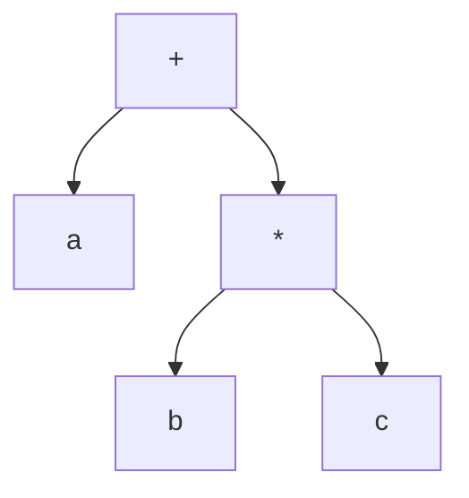
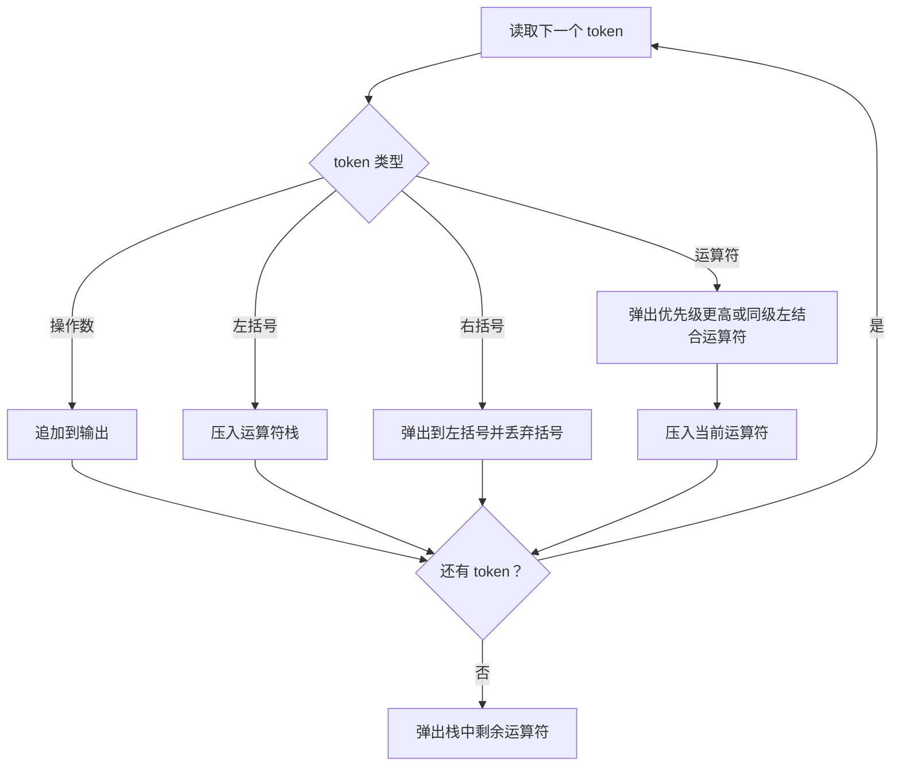

# 前中后缀表达式

> 本篇图示主题已整理扩展到[算法刷题系列第六十五篇：中缀、前缀与后缀表达式](/posts/2024/04/25/algorithm-practice-expression-notations/)，涵盖中缀转后缀、栈求值及表达式树遍历；带括号和一元符号的解析见[第八篇](/posts/2022/04/15/algorithm-practice-expression-evaluation/)。

表达式记法决定了运算符和操作数的排列方式。前缀、中缀和后缀表达式表示的是同一棵运算树，差别在于运算符放在哪里。

## 1. 三种记法

以 `a + b * c` 为例，乘法优先级高于加法，因此表达式树为：



从同一棵树得到三种遍历顺序：

|记法|生成规则|示例|
|---|---|---|
|中缀|左子树、运算符、右子树|`a + b * c`|
|前缀|运算符、左子树、右子树|`+ a * b c`|
|后缀|左子树、右子树、运算符|`a b c * +`|

中缀表达式最符合日常阅读习惯，但需要优先级和括号消除歧义。前缀和后缀把运算符位置编码进顺序中，在明确操作数边界后不需要括号。

## 2. 中缀转后缀：运算符栈

扫描 token 时：

1. 操作数直接输出。
2. 左括号压栈。
3. 遇到右括号时，弹出运算符直到左括号，并丢弃这对括号。
4. 遇到运算符时，弹出栈顶所有优先级更高的运算符；若优先级相同且当前运算符左结合，也弹出；然后压入当前运算符。
5. 扫描结束后弹出栈中剩余运算符。

下面用 `a + b * c - d` 展示状态（栈底在左侧）：

|扫描 token|输出|运算符栈|
|---|---|---|
|`a`|`a`|空|
|`+`|`a`|`+`|
|`b`|`a b`|`+`|
|`*`|`a b`|`+ *`|
|`c`|`a b c`|`+ *`|
|`-`|`a b c * +`|`-`|
|`d`|`a b c * + d`|`-`|
|结束|`a b c * + d -`|空|

`*` 优先级高于 `+`，因此在读到 `-` 时先输出 `*`；`+` 与 `-` 同级且左结合，所以也先输出 `+`。



## 3. 后缀表达式求值

遇到操作数就压入值栈；遇到二元运算符就弹出右操作数和左操作数，计算 `左 运算符 右` 后将结果压回。顺序很重要：栈顶是右操作数。

求值 `2 3 4 * +`：

|token|动作|值栈（底到顶）|
|---|---|---|
|`2`|压入|`[2]`|
|`3`|压入|`[2, 3]`|
|`4`|压入|`[2, 3, 4]`|
|`*`|计算 `3 * 4`|`[2, 12]`|
|`+`|计算 `2 + 12`|`[14]`|

合法表达式处理完后应恰好剩一个值。操作数不足、除数为零或最后剩余多个值，都表示表达式不合法或输入格式不符合约定。

## 4. 从后缀还原前缀

从左到右扫描后缀 token。操作数作为单节点表达式压栈；遇到运算符，依次弹出右表达式 `right`、左表达式 `left`，再压入 `operator + left + right`。例如 `a b c * +`：

```text
a       -> [a]
b       -> [a, b]
c       -> [a, b, c]
*       -> [a, ( * b c )]
+       -> [ ( + a ( * b c ) ) ]
```

实际实现应将表达式子树或 token 序列作为栈元素，而不是在存在多字符变量时简单拼接字符串。

## 5. 适用范围与常见陷阱

- 算法必须先做词法分析，正确区分多位数字、变量名和运算符。
- 一元负号与二元减号不是同一个 token；需要明确定义其优先级和结合性。
- 幂运算常按右结合处理，与 `+ - * /` 的左结合规则不同。
- 整数除法、浮点除法和溢出处理由具体语言或题目约定。

## 小结

前缀、后缀和中缀表达式对应同一运算树。掌握运算符栈的优先级规则，以及后缀求值时“先弹右操作数”的顺序，就能把表达式转换问题拆成清晰的栈操作。
