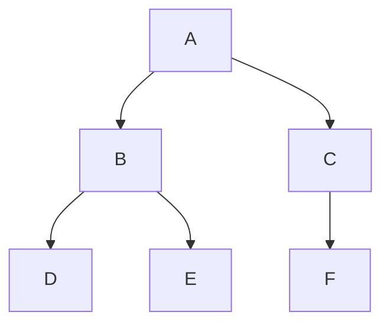
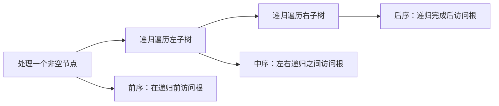

# 二叉树的遍历

> 本篇遍历示意图已配套整理到[算法刷题系列第二十八篇：树的搜索——前序、中序、后序与层序](/posts/2022/12/25/algorithm-practice-tree-traversals/)；递归定义与空树基例见[第二十七篇](/posts/2022/12/15/algorithm-practice-binary-tree-recursion/)。

二叉树的遍历方法：

遍历是按照确定次序访问每个节点。无论递归还是迭代，每个节点都应恰好访问一次，时间复杂度为 `O(n)`。

## 1. 示例树与三种深度优先顺序



对于上图：

|遍历|访问顺序|规则|
|---|---|---|
|前序|`A B D E C F`|根、左子树、右子树|
|中序|`D B E A C F`|左子树、根、右子树|
|后序|`D E B F C A`|左子树、右子树、根|

三种遍历的区别只是“根节点”相对左右子树的访问时机。每个子树继续应用同一规则，因此可以递归定义。



## 2. 层序遍历

层序遍历按从上到下、每层从左到右访问节点，使用队列维护“下一批待访问节点”：

```text
队列初始放入根
重复直到队列为空：
    弹出队首节点并访问
    若左孩子存在，将左孩子入队
    若右孩子存在，将右孩子入队
```

示例树的层序结果为 `A B C D E F`。队列保证先发现的较浅节点先处理，因此层序遍历也是树上的广度优先搜索。

## 3. 递归模板

```python
def preorder(node):
    if node is None:
        return
    visit(node)
    preorder(node.left)
    preorder(node.right)
```

中序和后序只需移动 `visit(node)` 的位置。空节点是递归基例；没有基例会无限递归。

递归调用栈空间与树高 `h` 成正比：平衡树约为 `O(log n)`，退化成链的树可能达到 `O(n)`。若输入树可能极深，可考虑用显式栈迭代，避免语言调用栈溢出。

## 4. 迭代思路与典型用途

- **前序迭代**：栈先压右孩子，再压左孩子，这样左子树先弹出。
- **中序迭代**：沿左链压栈；弹出并访问一个节点后，转向其右子树。
- **后序迭代**：可用两个栈，或记录上一次访问的节点判断右子树是否已处理。
- **层序迭代**：队列保存当前发现但尚未访问的节点。

选择遍历顺序的经验：

- 前序常用于复制树、生成前缀结构或先处理父节点。
- 中序对二叉搜索树产生递增序列。
- 后序适合释放树、计算子树高度或先得出子问题结果。
- 层序适合按层统计、找最短层数或构造树的层级表示。

## 5. 遍历序列的限制

单独一条前序或后序序列通常不能唯一确定一般二叉树的形状。若节点值互异，前序加中序或后序加中序可以唯一还原；若允许重复值，还需额外标识或位置约定。

## 小结

深度优先遍历由根节点访问时机区分；层序遍历依靠队列逐层扩展。先明确输出要求，再选择遍历顺序和递归或迭代实现。
