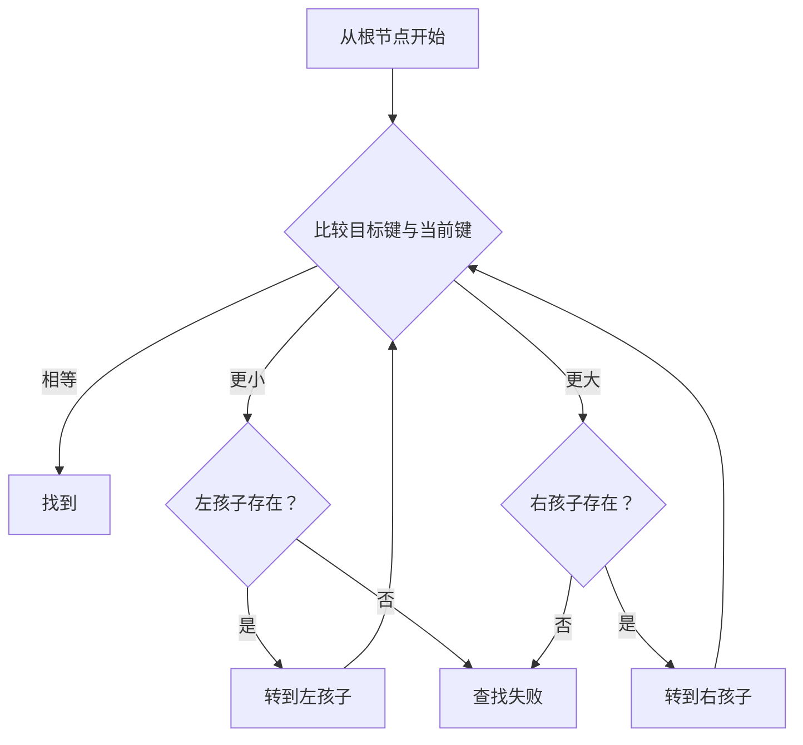
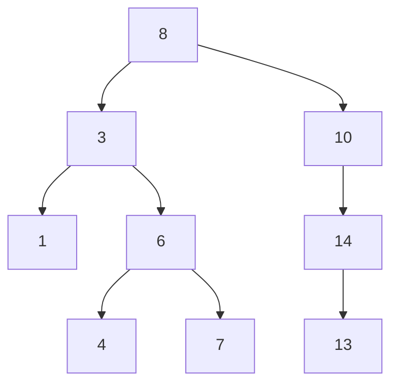

# 名词解释：二叉排序树

> BST 定义及操作现已扩展为[算法刷题系列第五十九篇：二叉搜索树——查找、插入与删除](/posts/2024/02/10/algorithm-practice-binary-search-tree/)；AVL、B 树和 B+ 树见[第六十篇](/posts/2024/02/25/algorithm-practice-balanced-search-trees/)。

**名词解释：二叉排序树**

二叉排序树也叫二叉搜索树（BST）。对树中任意节点 `x`，其左子树所有键都小于 `x.key`，右子树所有键都大于 `x.key`，左右子树本身也满足同一性质。本文假设键唯一；若实际问题允许重复键，必须统一规定重复键的存放策略。

## 1. 搜索为什么有效

从根节点开始比较目标键 `k`：

- `k == node.key`：找到。
- `k < node.key`：目标若存在，只可能在左子树。
- `k > node.key`：目标若存在，只可能在右子树。

每一步都排除一个子树，因此工作量与树高 `h` 成正比。

## 2. 插入与中序性质

插入过程与查找相同，沿比较结果向左或向右，直到对应孩子为空，再把新节点放在那里。沿途不会改变已有节点的位置。

BST 的中序遍历顺序是“左子树、根、右子树”，因此输出键值递增。这也提供了验证实现是否满足 BST 性质的简单方法。

上图中序输出为 `1, 3, 4, 6, 7, 8, 10, 13, 14`。

## 3. 删除节点的三种情况

1. **叶节点**：直接让父节点对应的孩子引用变为空。
2. **只有一个孩子**：让父节点直接接到该孩子，跳过待删除节点。
3. **有两个孩子**：找到右子树中最小节点（中序后继），用其键替换当前键，再删除这个后继。后继没有左孩子，因此删除会退化为前两种情况之一。

## 4. 复杂度的关键是树高

|情况|树高|查找/插入/删除|
|---|---:|---:|
|平衡或接近平衡|`O(log n)`|`O(log n)`|
|按有序数据依次插入|`O(n)`|`O(n)`|

普通 BST 不会自动保持平衡。例如依次插入 `1, 2, 3, 4` 会形成向右倾斜的链。因此若需要稳定的对数级操作，应采用 AVL、红黑树等自平衡搜索树。

## 5. 与其他结构的区别

- **普通二叉树**：只规定最多两个孩子，不保证键值顺序。
- **二叉搜索树**：利用键值顺序缩小查找范围，但高度可能退化。
- **哈希表**：适合精确键查找，不自然支持有序遍历和范围查询。

更完整的插入、删除代码以及平衡树延伸见[系列第 59 篇](/posts/2024/02/10/algorithm-practice-binary-search-tree/)和[第 60 篇](/posts/2024/02/25/algorithm-practice-balanced-search-trees/)。

## 小结

BST 的核心不变量是“左小右大”，查找和更新成本由高度决定。中序遍历可检验顺序性质；删除两个孩子的节点时，使用中序后继将问题化简为删除至多一个孩子的节点。
