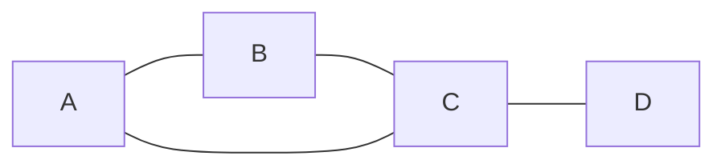
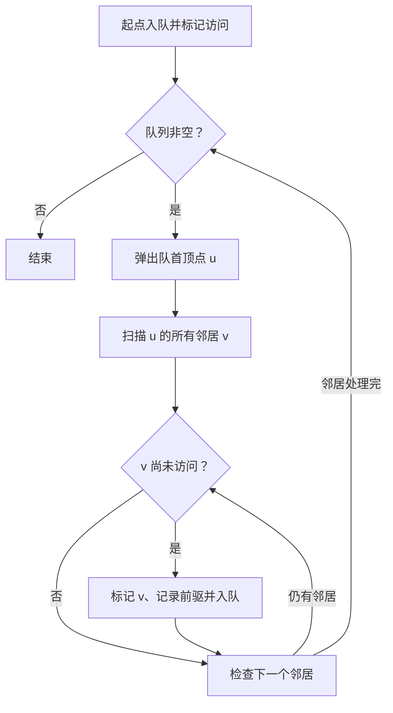

# 图

> 本篇图论主题已整理进[算法刷题系列第五阶段](/posts/2022/01/01/algorithm-practice-series-roadmap/)：从[图论 BFS](/posts/2023/04/15/algorithm-practice-graph-bfs/)和 DFS 开始，继续学习拓扑排序、最小生成树与最短路。

图由顶点集合 `V` 和边集合 `E` 构成，记为 `G = (V, E)`。它适合描述“对象之间存在关系”的问题，例如城市道路、课程依赖、设备网络和社交关系。

## 1. 图的类型

- **无向图**：边没有方向，`u` 与 `v` 相连意味着彼此可达。
- **有向图**：边写作 `u -> v`，方向表示依赖或单向关系。
- **带权图**：边附带距离、成本、时间等数值。
- **连通图/连通分量**：无向图中任意两点是否可达；不连通图由多个分量组成。
- **环**：沿边出发后能回到起点的路径。无环有向图称为 DAG，常用于依赖排序。



这是一张无向图。若所有边带方向，关系可能不再对称；将边标成 `A --> B` 就表示从 A 到 B 可达，而不自动表示反向可达。

## 2. 邻接表与邻接矩阵

### 邻接表

为每个顶点保存相邻顶点列表。对稀疏图通常更节省空间：

```text
A: B, C
B: A, C
C: A, B, D
D: C
```

空间为 `O(V + E)`，遍历某顶点的邻居只访问该顶点实际关联的边。若是无向图，每条边在两个端点的列表中各存一次。

### 邻接矩阵

使用 `V × V` 矩阵记录边是否存在或边权。空间为 `O(V²)`，判断任意两点间是否直接相连为 `O(1)`，适合顶点不多或图较稠密的情况。

|需求|更常见的选择|
|---|---|
|稀疏大图、频繁遍历邻居|邻接表|
|稠密小图、频繁检查任意点对|邻接矩阵|

## 3. BFS 与 DFS

**广度优先搜索（BFS）**使用队列，从起点逐层向外扩展。在无权图中，第一次到达某顶点时得到的路径具有最少边数。



**深度优先搜索（DFS）**沿一条路径尽量深入，无法继续时回退。可用递归或显式栈实现，适合连通性、环检测、连通分量等任务。

使用邻接表时，BFS 和 DFS 的时间复杂度均为 `O(V + E)`。为了处理不连通图，要从每个尚未访问的顶点重新启动一次搜索。

## 4. 建模与边界检查

开始写图算法前先明确：

1. 顶点如何编号，输入是否可能有重复边或自环。
2. 边是否有方向、是否有权重。
3. 题目需要可达性、最少边数、拓扑顺序还是最小代价。
4. 图可能不连通吗？节点数量和边数量上限是多少？

BFS 的“最短”只针对无权或等权边数；带不同权重时，不能直接用普通 BFS 替代 Dijkstra 等最短路算法。

## 小结

图建模的关键是把对象当作顶点、关系当作边，并根据稀疏度选择存储方式。BFS 适合无权最少边数问题，DFS 适合深入探索与结构分析；算法选择必须与边的方向和权重相匹配。
