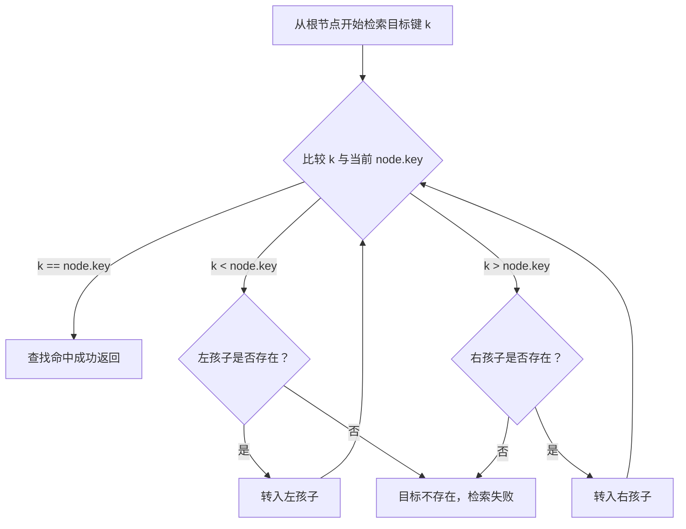
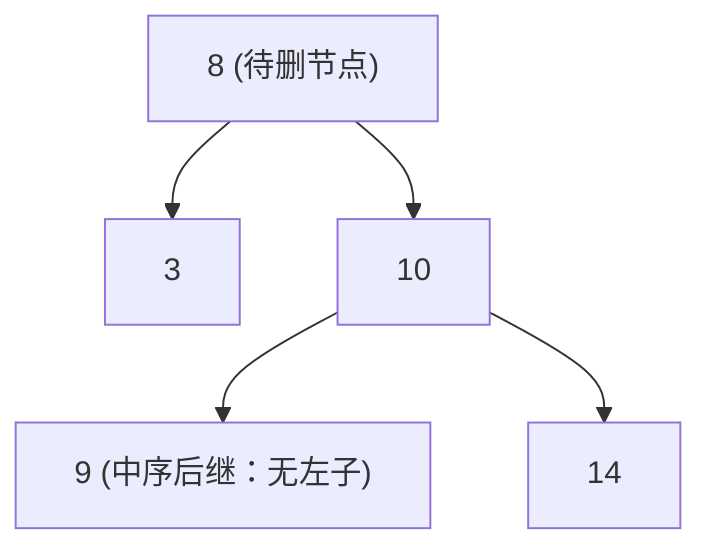
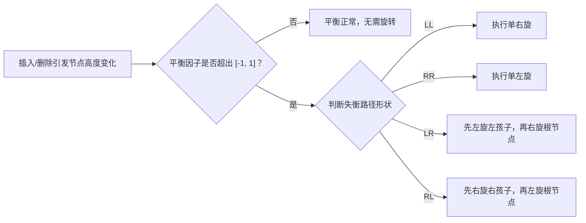
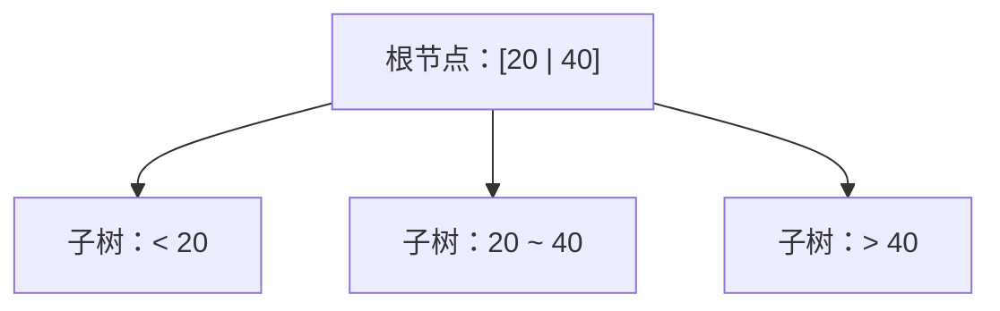
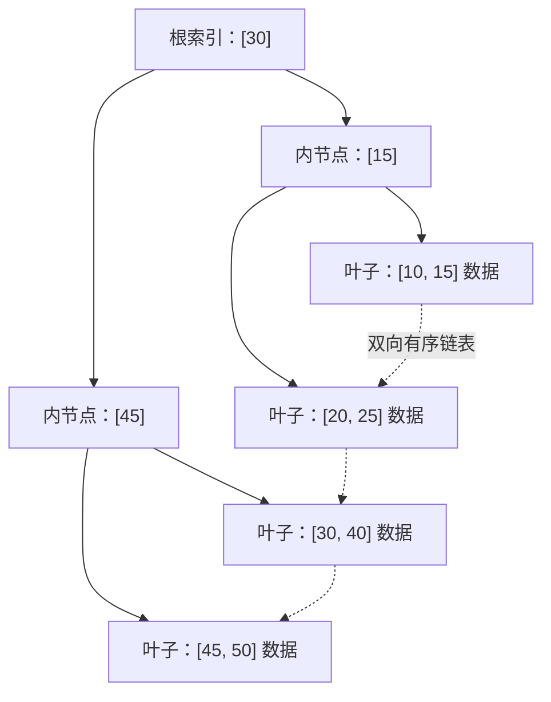

# 二叉排序树与查找树

> 本篇关于查找树的核心概念已在[算法刷题系列第五十九篇：二叉搜索树](/posts/2024/02/10/algorithm-practice-binary-search-tree/)与[第六十篇：平衡搜索树](/posts/2024/02/25/algorithm-practice-balanced-search-trees/)中展开推导，包含了完整的旋转操作与工程实践。

查找树（Search Tree）通过在树结构中维护有序性不变量，大幅度缩小查找目标键所需访问的节点数量。本篇从二叉搜索树（BST）的定义与动态操作出发，深入探讨树高对性能的决定性影响，进而介绍自平衡二叉搜索树（AVL 树）以及面向外存块存储的多路平衡查找树（B 树与 B+ 树）。

## 1. 二叉排序树（BST）的核心性质

二叉排序树又称二叉搜索树（Binary Search Tree，BST）。其核心不变量是：对于树中任意节点 $x$：
- 若其左子树不为空，则左子树上所有节点的键值均**小于** $x$ 的键值；
- 若其右子树不为空，则右子树上所有节点的键值均**大于** $x$ 的键值；
- 其左右子树也各自是一棵二叉搜索树。

BST 的**中序遍历**严格遵循“左子树 $\rightarrow$ 根节点 $\rightarrow$ 右子树”的顺序，因此对其进行中序遍历可自然输出一个单调严格递增的有序键序列。

## 2. BST 的检索流程与动态操作

### 检索过程

从根节点出发，将目标值 $k$ 与当前节点值进行比较：
1. 若 $k = \text{node.key}$，则查找成功；
2. 若 $k < \text{node.key}$，则只需进入左子树继续检索；
3. 若 $k > \text{node.key}$，则只需进入右子树继续检索；
4. 若落入空节点，则查找失败。

每一次比较均可排除整个另一侧子树，因此检索的工作量严格取决于路径经过的节点数，即树高 $h$。

### 节点插入

新键的插入过程与检索类似：从根开始沿比较结果向下寻路，直至找到满足空条件的叶子或孩子位置，将新节点作为叶子接入树中，沿途不需要改变原有其他节点的相对拓扑。

### 节点删除的三种情况

删除节点需要保持“左小右大”的 BST 不变量，根据被删除节点的子节点数分三种情况处理：

1. **被删节点为叶子节点（度为 0）**：直接切断其父节点对它的引用，置空即可。
2. **被删节点只有一个孩子（度为 1）**：让其父节点直接连接该独子，跳过被删节点。
3. **被删节点有两个孩子（度为 2）**：在右子树中找到键值最小的节点（**中序后继**），用后继节点的键值覆盖待删节点的值，然后转而在右子树中删除该后继节点。因为中序后继必定没有左孩子，所以问题化简为前两种简单情况。

## 3. 为什么需要自平衡：树高与退化

BST 的增删查时间复杂度正比于树高 $h$：

| 树的拓扑形态 | 树高 $h$ | 单次检索 / 插入 / 删除复杂度 |
| :--- | :--- | :--- |
| **高度平衡或近似随机分布** | $O(\log n)$ | $O(\log n)$ |
| **按单调递增/递减序列依次插入** | $O(n)$ | 退化为单链表，性能跌落为 $O(n)$ |

普通 BST 无法保证树高稳定。为了避免最坏情况下性能退化，必须引入自平衡机制。

## 4. 自平衡二叉搜索树：AVL 树

AVL 树是最早提出的自平衡二叉搜索树。它规定：**树中任意节点的左右子树高度差（平衡因子）的绝对值不能超过 1**。

当插入或删除节点破坏了平衡约束时，AVL 树通过**树旋转（Rotation）**在常数步内恢复高度平衡。共有四种典型失衡形态：

| 失衡形态 | 触发原因 | 平衡修复动作 |
| :--- | :--- | :--- |
| **LL 型** | 节点的左孩子的左子树过高导致失衡 | 对失衡节点执行单次**右旋** |
| **RR 型** | 节点的右孩子的右子树过高导致失衡 | 对失衡节点执行单次**左旋** |
| **LR 型** | 节点的左孩子的右子树过高导致失衡 | 先对左孩子**左旋**，再对失衡节点**右旋** |
| **RL 型** | 节点的右孩子的左子树过高导致失衡 | 先对右孩子**右旋**，再对失衡节点**左旋** |

AVL 树确保所有操作的最坏时间复杂度稳定在严密的 $O(\log n)$。

## 5. 面向外存与磁盘的多路平衡查找树：B 树与 B+ 树

在文件系统与数据库等外存场景中，磁盘 I/O 耗时远大于内存计算。多路平衡树通过大幅增加节点分支度数、压缩树高，达到单次寻址最少磁盘 I/O 次数的目的。

### B 树（B-Tree）

B 树让单个节点容纳多个有序的关键字与多个子树指针：
- 节点内保存多个升序键值 $[k_1, k_2, \dots, k_m]$；
- $m$ 个键值自然将数轴切分为 $m + 1$ 个子区间，对应 $m + 1$ 个子节点指针；
- 所有叶子节点均位于相同的绝对深度；
- 通过节点分裂（Overflow）与借位/合并（Underflow）动态维持多路平衡。

### B+ 树（B+ Tree）

B+ 树是专为数据库索引设计的演进形态：
1. **数据全在叶子层**：非叶子内部节点仅存储键值作为路由索引，不存储具体数据行记录，这使得单个索引页能容纳更多分支，树的高度更矮（通常 3 到 4 层即可支撑千万级数据）。
2. **叶子节点双向链表**：所有叶子节点按键值顺序使用指针串联成双向链表。在范围查询（如 `WHERE id BETWEEN 10 AND 100`）时，只需定位起点叶子，随后沿链表顺序读取，无需多次反复回溯遍历树枝。

## 6. 各类查找树对比与选型

| 查找树结构 | 结构特征 | 核心优势 | 典型应用领域 |
| :--- | :--- | :--- | :--- |
| **二叉搜索树（BST）** | 二叉树，左小右大 | 逻辑直观，实现极简 | 算法基础教学、无退化风险的内部结构 |
| **AVL 树** | 严格平衡二叉搜索树 | 查找性能极致稳定 | 读远多于写的内存结构 |
| **红黑树** | 弱平衡二叉搜索树（黑高平衡） | 插入删除旋转少，综合吞吐量高 | `std::map`、Java `TreeMap`、Linux 内核调度 |
| **B 树** | 多路平衡树，数据分布在全树节点 | 树高浅，点查询平均路径短 | 文件系统索引、MongoDB 数据引擎 |
| **B+ 树** | 多路平衡树，仅叶子存数据并串联 | 范围扫描极佳，单页分支度极高 | MySQL InnoDB 引擎索引体系 |

## 小结

查找树的演进线索非常清晰：以普通 BST 的“键值序缩小检索范围”为起点；通过 AVL 与红黑树解决“树高退化”问题；在块存储时代，演化出多路分支的 B 树与为范围扫描而生的 B+ 树。深入理解查找树的不变量与平衡机制，是掌握高效检索技术的核心关键。
