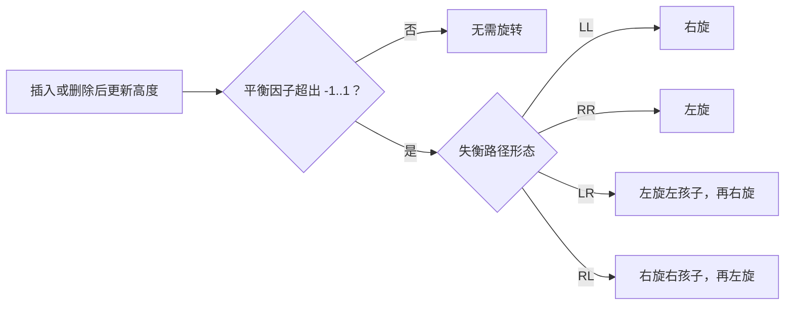
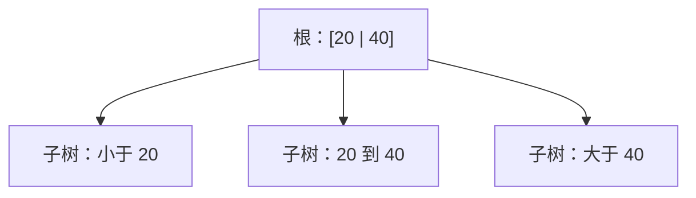
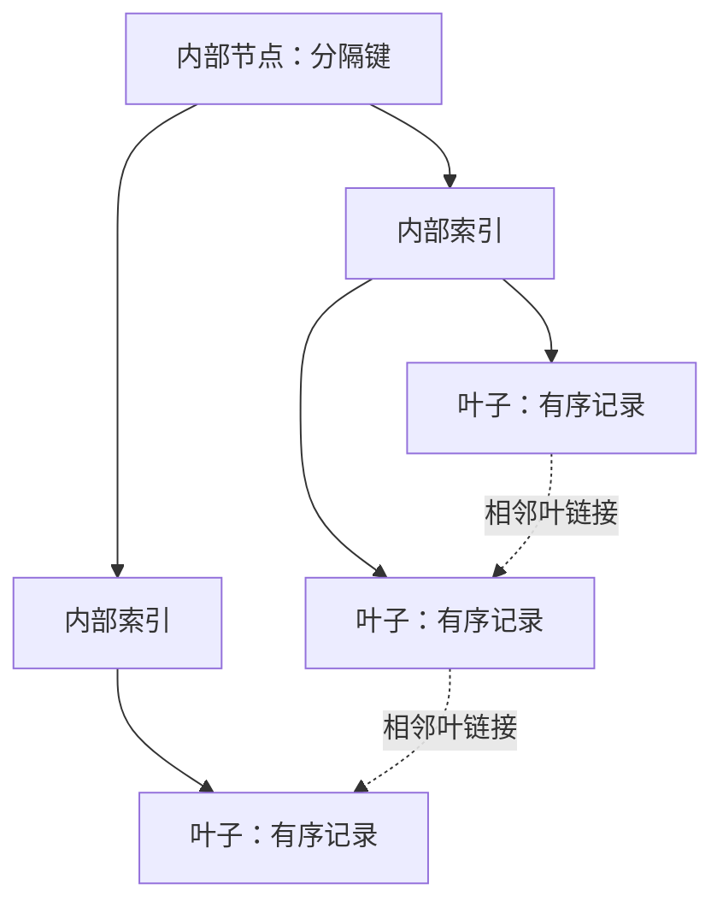

# 查找树

> 本篇关于查找树的旧图示已扩展到[算法刷题系列第五十九篇：二叉搜索树](/posts/2024/02/10/algorithm-practice-binary-search-tree/)和[第六十篇：平衡搜索树](/posts/2024/02/25/algorithm-practice-balanced-search-trees/)，补充了操作推导、复杂度与应用场景。

查找树通过组织键值顺序，减少查找时需要检查的节点。本篇从二叉搜索树出发，说明树高为何重要，以及 AVL、B 树和 B+ 树分别解决什么问题。

## 1. 二叉搜索树：按大小决定方向

对每个节点，左子树键值小于节点，右子树键值大于节点。查找时每次比较后只进入一个子树。查找、插入和删除的时间均与树高 `h` 成正比。

如果数据以近似随机顺序插入，树通常较平衡；若按递增顺序插入，树可能退化成链，操作从 `O(log n)` 变成 `O(n)`。

## 2. AVL 树：用旋转恢复高度平衡

AVL 树要求每个节点左右子树高度差的绝对值不超过 1。插入或删除后，若某个祖先失衡，通过局部旋转恢复平衡。四种典型形态可归纳为：

|形态|失衡位置|修复方式|
|---|---|---|
|LL|左孩子的左子树过高|对失衡节点右旋|
|RR|右孩子的右子树过高|对失衡节点左旋|
|LR|左孩子的右子树过高|先左旋左孩子，再右旋失衡节点|
|RL|右孩子的左子树过高|先右旋右孩子，再左旋失衡节点|

AVL 树高度保持 `O(log n)`，因此查找、插入和删除都有对数级上界。严格平衡会增加更新时的旋转和维护工作。

## 3. B 树：为外存减少访问次数

内存与磁盘访问成本差异很大。B 树让一个节点保存多个有序键和多个孩子指针，使每次读取节点后可以排除更大范围的键值。节点分支数越高，树的层数通常越低，适合页式存储。

以一个节点存储多个分隔键为例：

真实 B 树还要求节点键数和孩子数满足阶数约束，并通过分裂、合并或借位保持平衡。所有叶子位于同一深度，查找路径因此有界。

## 4. B+ 树：为范围扫描组织叶子

B+ 树把记录或记录指针集中在叶子层，内部节点主要保存分隔键；叶子通常按键顺序链接。这样既能保持平衡查找，也能从一个范围的起点开始顺序扫描相邻叶子。

数据库索引常使用 B+ 树的变体，因为它能兼顾点查找与范围查询，并通过高分支数减少磁盘页访问。具体实现会因数据库而异。

## 5. 选择思路

|结构|主要优点|典型用途|
|---|---|---|
|普通 BST|结构简单，支持有序遍历|教学、小型内存数据|
|AVL|严格控制高度，查找稳定|读操作较多的内存索引|
|B 树|多路分支，减少层数|外存索引、文件系统|
|B+ 树|叶子有序链接，利于区间扫描|数据库索引|

## 小结

查找树的共同目标是减少定位键值所需的比较或存储访问。普通 BST 依赖输入形态，AVL 用旋转维持二叉平衡，B 树和 B+ 树通过多路节点适应块存储。
