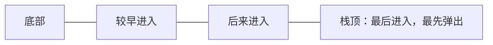
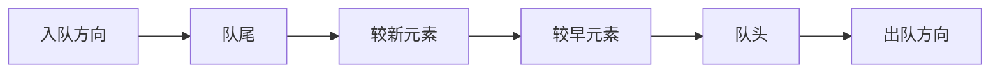

# 栈和队列

> 栈与队列的定义、操作和刷题场景已分别整理到[算法刷题系列第九篇：栈](/posts/2022/04/25/algorithm-practice-stack/)与[第十篇：队列](/posts/2022/05/10/algorithm-practice-queue-and-bfs/)。

栈和队列都是操作受限的线性结构。它们的区别不在于保存什么数据，而在于元素从哪里进入、从哪里离开。

## 1. 栈：后进先出

栈只在同一端执行插入和删除。常见操作为 `push`（入栈）、`pop`（出栈）和 `peek`（查看栈顶）；这些操作通常为 `O(1)`。

栈适用于括号匹配、函数调用、深度优先搜索、表达式求值和单调栈问题。用数组实现时维护栈顶下标；用链表实现时通常在头部插入和删除。无论哪种方式，都要检查空栈和容量边界。

## 2. 队列：先进先出

队列在队尾插入，在队头删除。`enqueue` 将元素加入队尾，`dequeue` 移除队头，`front` 查看队头。队列用于任务调度、消息缓冲和广度优先搜索。

## 3. 用循环数组实现队列

若数组长度为 `capacity`，维护 `head`（队头下标）和当前元素数 `size`：

- 入队位置：`(head + size) mod capacity`
- 出队后：`head = (head + 1) mod capacity`，再令 `size -= 1`
- 空队列：`size == 0`
- 满队列：`size == capacity`

取模让数组尾部用完后回到下标 0，避免每次出队都移动剩余元素。使用 `head` 和 `size` 能清楚区分空与满；另一种实现会额外留一个空槽，但容量利用率会少一个位置。

## 4. 链式队列与不变量

链式队列维护 `head` 与 `tail` 两个引用：

- 入队：将新节点接在 `tail` 后，再更新 `tail`。
- 出队：让 `head` 指向原头节点的后继。
- 若出队后队列变空，必须同时把 `tail` 设为空。

维护“空队列时 head 和 tail 都为空，非空时都指向有效节点”的不变量，可以避免单元素队列出队后留下悬空尾指针。

## 5. 如何选择

|需要的处理顺序|结构|
|---|---|
|最近加入的任务先处理|栈|
|最早加入的任务先处理|队列|
|按距离逐层扩展图或树|队列|
|沿分支深入，必要时回退|栈或递归调用栈|

## 小结

栈的核心是后进先出，队列的核心是先进先出。它们常能以常数时间完成端点操作；实现时重点检查空/满状态以及队列从一个元素变为空时的边界。
