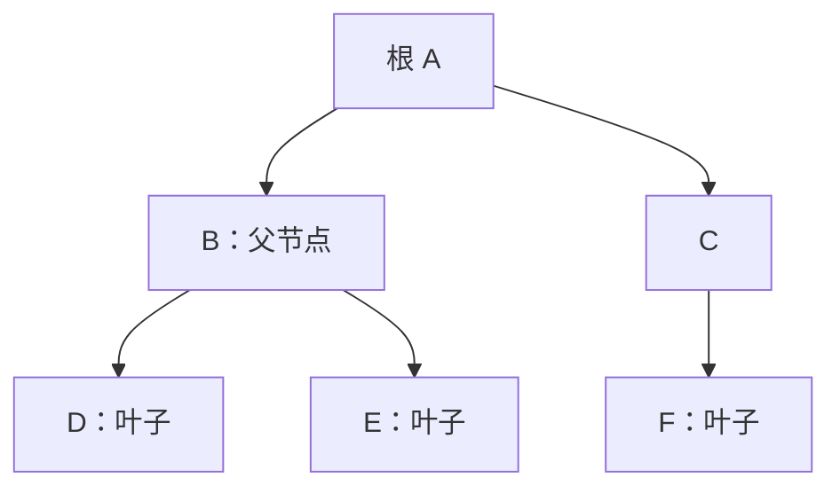
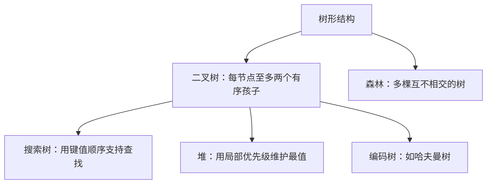

# 树和二叉树

> 本篇树与二叉树图示分别由[算法刷题系列第二十七篇：二叉树递归模型](/posts/2022/12/15/algorithm-practice-binary-tree-recursion/)、[第二十八篇：树的遍历](/posts/2022/12/25/algorithm-practice-tree-traversals/)和[第六十六篇：哈夫曼树](/posts/2024/05/10/algorithm-practice-huffman-coding/)补充为完整教程。

树是由节点和父子关系构成的层次结构。若有 `n` 个节点，则树有 `n - 1` 条边；除根节点外，每个节点恰有一个父节点，并且不存在环。

## 1. 树的基本术语

- **根**：没有父节点的节点。
- **叶子**：没有孩子的节点。
- **深度**：从根到该节点的边数；根深度为 0。
- **高度**：从该节点到最深叶子的最长边数。
- **子树**：某节点及其所有后代构成的树。

## 2. 二叉树及常见形态

二叉树中每个节点至多有两个孩子，分别称为左孩子和右孩子。左右位置有意义，不能因为值相同就互换视作同一结构。

- **满二叉树**：每层节点都达到最大数量。
- **完全二叉树**：除最后一层外均满，最后一层从左向右连续排列。
- **平衡树**：左右子树高度差受到约束；“二叉树”本身并不保证平衡。

高度为 `h` 的二叉树最多有 `2^(h+1) - 1` 个节点。按根深度从 0 开始，第 `d` 层最多有 `2^d` 个节点。完全二叉树使用从 0 开始的数组下标时，节点 `i` 的左孩子下标为 `2i + 1`，右孩子为 `2i + 2`。

## 3. 两种存储方式

### 链式节点

每个节点保存值、左孩子引用和右孩子引用。适合形状不规则的树；节点之间不要求连续存放。

### 数组下标

对完全二叉树，父子关系可通过下标公式计算，适合堆。若树很稀疏，数组会留下大量空位，因此不适合作为通用二叉树的唯一表示。

## 4. 遍历、树与森林

前序、中序、后序和层序遍历分别适合不同操作，详见[二叉树遍历笔记](/posts/2018/03/02/binary-tree-traversal/)。普通树可以把每个节点的多个孩子存成列表；也可以用“左孩子—右兄弟”表示法，将一般树转换成二叉链式结构。

森林由多棵互不相交的树组成。把每棵树的根连到一个虚拟根下面，就能将森林视作一棵树，便于递归处理。

## 5. 线索树与哈夫曼树

**线索二叉树**利用普通二叉树中大量为空的孩子指针，改为指向遍历序列中的前驱或后继。节点需要额外标志区分“孩子链接”和“线索”；这种结构可以减少遍历时对辅助栈或递归的依赖，但更新节点时维护更复杂。

**哈夫曼树**根据符号出现频率构造带权路径长度较小的二叉树。反复合并权值最小的两棵树可以得到最优前缀码，详见[系列第 66 篇](/posts/2024/05/10/algorithm-practice-huffman-coding/)。

## 小结

树适合表达层次关系；二叉树额外限制每个节点至多两个有序孩子。不要把普通二叉树与搜索树、堆、平衡树混为一谈：它们在通用树形结构上分别增加了不同的不变量。
