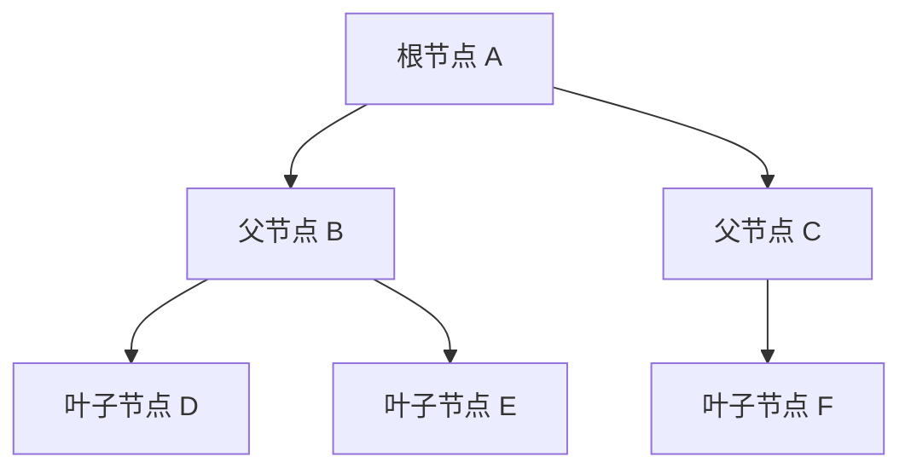
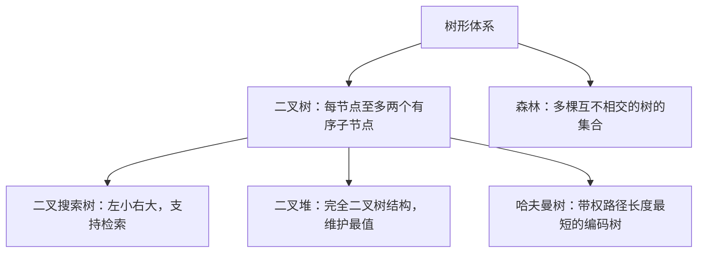
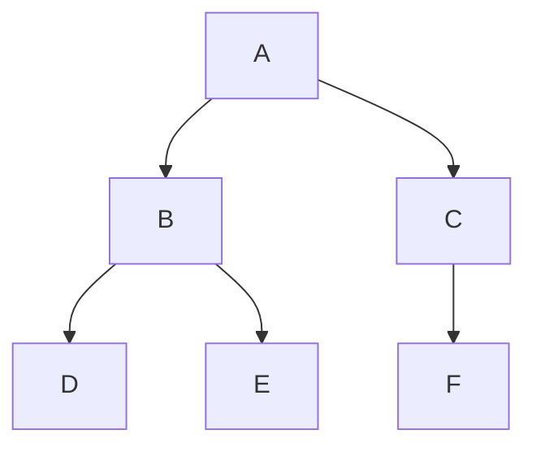

# 树和二叉树及其遍历

> 本篇树与二叉树模型已分别在[算法刷题系列第二十七篇：二叉树递归模型](/posts/2022/12/15/algorithm-practice-binary-tree-recursion/)、[第二十八篇：树的遍历](/posts/2022/12/25/algorithm-practice-tree-traversals/)和[第六十六篇：哈夫曼树](/posts/2024/05/10/algorithm-practice-huffman-coding/)中进行了完整教程化展开。

树（Tree）是由节点和父子边构成的典型分层数据结构。如果一棵树拥有 $n$ 个节点，则必定恰好存在 $n - 1$ 条边；除唯一的根节点外，每个节点都有且仅有一个父节点，整个结构中不存在任何环路。

## 1. 树的核心概念与术语

- **根节点（Root）**：树的最顶层节点，没有父节点。
- **叶子节点（Leaf）**：没有子节点的端点节点。
- **度（Degree）**：节点的子树数目称为节点的度；树中所有节点度的最大值称为树的度。
- **深度（Depth）**：从根节点到该节点的路径边数，根节点的深度规定为 0。
- **高度（Height）**：从该节点到其最深叶子节点的最长简单路径边数。
- **子树（Subtree）**：某个节点及其所有子孙节点共同构成的独立树结构。



## 2. 二叉树及常见形态

二叉树（Binary Tree）是一种特殊的树形结构，每个节点至多拥有两个孩子，分别称作**左孩子（Left Child）**和**右孩子（Right Child）**。二叉树的子树严格区分左右顺序，即便只有一个孩子，也要明确区分是左孩子还是右孩子。

- **满二叉树（Full Binary Tree）**：除最后一层叶子节点外，所有分支节点的度都为 2，所有叶子都在同一层。
- **完全二叉树（Complete Binary Tree）**：若二叉树高度为 $h$，除第 $h$ 层外其他各层的节点数都达到最大，且第 $h$ 层的叶子节点从左到右依次连续排列。
- **二叉搜索树（BST）**：对每个节点，左子树所有键值小于它，右子树所有键值大于它。



## 3. 存储结构实现

### 链式存储（二叉链表）

每个节点包含三个基本字段：数据域 `val`、左孩子指针 `left` 和右孩子指针 `right`。适合任意形状的普通二叉树，插入与删除节点只需重连引用。

### 顺序存储（数组）

利用完全二叉树的父子序号规律：若根节点下标为 0，则对于下标为 $i$ 的节点：
- 左孩子下标为 $2i + 1$
- 右孩子下标为 $2i + 2$
- 父节点下标为 $\lfloor (i - 1) / 2 \rfloor$

完全二叉树和二叉堆使用数组存储极为紧凑高效；但对于倾斜或稀疏树，数组会产生大量闲置空洞。

## 4. 二叉树的四种遍历方式

遍历是指按照某种确定规则，依次访问二叉树中的每个节点，且使每个节点恰好被访问一次。遍历时间复杂度均为 $O(n)$。

### 深度优先遍历（前序、中序、后序）

深度优先遍历根据**根节点的访问时机**进行区分：

| 遍历方式 | 访问次序规则 | 典型用途与性质 |
| :--- | :--- | :--- |
| **前序遍历（Pre-order）** | 根 $\rightarrow$ 左子树 $\rightarrow$ 右子树 | 树的克隆复制、序列化前缀表达 |
| **中序遍历（In-order）** | 左子树 $\rightarrow$ 根 $\rightarrow$ 右子树 | 二叉搜索树中序遍历可得到单调递增序列 |
| **后序遍历（Post-order）** | 左子树 $\rightarrow$ 右子树 $\rightarrow$ 根 | 释放销毁树、自底向上计算子树高度或规模 |



对于上图二叉树：
- **前序遍历**：`A -> B -> D -> E -> C -> F`
- **中序遍历**：`D -> B -> E -> A -> C -> F`
- **后序遍历**：`D -> E -> B -> F -> C -> A`

#### 递归模板

```python
def traverse(node):
    if node is None:
        return
    # visit(node)  # 前序位置
    traverse(node.left)
    # visit(node)  # 中序位置
    traverse(node.right)
    # visit(node)  # 后序位置
```

递归调用栈的深度等于当前递归路径的高度。平衡树平均空间开销为 $O(\log n)$，单支倾斜退化树最坏可达 $O(n)$。

### 广度优先遍历（层序遍历）

层序遍历借助**先进先出（FIFO）队列**按层次从上到下、每层从左向右逐节点访问：

```python
from collections import deque

def level_order(root):
    if not root:
        return []
    res = []
    queue = deque([root])
    while queue:
        node = queue.popleft()
        res.append(node.val)
        if node.left:
            queue.append(node.left)
        if node.right:
            queue.append(node.right)
    return res
```

层序遍历可直观反映树的横向结构，也是无权树结构求最短路径步数的核心算法。

## 5. 遍历序列的唯一还原约束

仅凭单一前序、中序或后序遍历序列，无法唯一确定一棵一般二叉树的形态结构。若节点值互不相同，则必须满足以下条件之一方可唯一重构原二叉树：
- **前序序列 + 中序序列**（由前序确定根节点，在中序中划分左右子树）
- **后序序列 + 中序序列**（由后序末尾确定根节点，在中序中划分左右子树）

而前序序列加后序序列无法唯一还原二叉树，因为无法确定单孩子节点到底隶属于左分支还是右分支。

## 小结

树结构是现实世界层级关系的自然抽象，二叉树则在此基础上将度数限制为至多两个。掌握前序、中序、后序与层序遍历的本质区别及其栈/队列实现，是解决树形递归模型、二叉搜索树、分治算法以及高级树状结构的基础。
