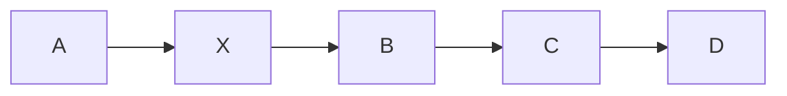
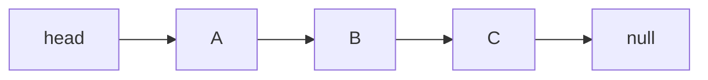
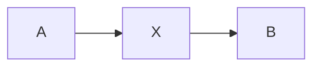

# 线性表

> 线性表的顺序存储与链式存储现已整理扩展到[算法刷题系列第五十八篇：线性表——数组与链表如何选择](/posts/2024/01/25/algorithm-practice-linear-list-array-linked-list/)；链表的局部重连实践见[第十一篇](/posts/2022/05/25/algorithm-practice-linked-list/)。

线性表是由 `n` 个同类型元素构成的有限序列，记作 `a0, a1, ..., a(n-1)`。元素有确定的先后次序；除首尾外，每个元素都有唯一的直接前驱和后继。

## 1. 抽象操作

常见线性表操作包括读取第 `i` 个元素、查找值、插入、删除、遍历和判空。抽象定义并不要求数据一定连续存放；动态数组和链表都可以实现线性表，但操作代价不同。

## 2. 顺序表：数组保存元素

顺序表把元素存放在连续区域中。下标 `i` 可直接定位第 `i` 个元素。若在中间插入或删除，为保持顺序通常需要移动一段元素。

在 `[A, B, C, D]` 的下标 1 插入 `X`：

实现时从尾部向后移动元素，避免覆盖未搬移的数据。删除则从删除位置开始，把后续元素向前移动。

动态数组会预留容量；容量耗尽时分配更大的连续区域并复制元素。扩容这一次可能耗时 `O(n)`，但多次追加平均下来通常是摊还 `O(1)`。

## 3. 链表：节点通过引用相连

单链表节点由数据和 `next` 引用组成。逻辑相邻的节点不必在内存中相邻。

在节点 `A` 后插入 `X` 时，先保存 `A` 原先的后继，再重连：

若已持有 `A`，插入只需常数次引用赋值；但要按下标找到 `A`，仍需从头走到该位置，时间为 `O(n)`。删除中间节点通常需要持有它的前驱。

双向链表在每个节点增加 `prev` 引用，便于从节点向前移动和删除已定位节点，但要维护更多链接。循环链表把尾部连回头部，遍历时不能再以 `node is None` 作为唯一停止条件。

## 4. 操作复杂度对比

|操作|动态数组|单链表|
|---|---:|---:|
|按索引读取|`O(1)`|`O(n)`|
|按值查找|`O(n)`|`O(n)`|
|末尾追加|摊还 `O(1)`|有尾指针时 `O(1)`|
|已知位置插入/删除|通常 `O(n)` 移动|已定位前驱时 `O(1)`|
|额外空间|通常较紧凑|每节点需保存引用|

## 5. 如何选择

- 频繁按索引读取、连续遍历：优先考虑数组或动态数组。
- 经常在已知节点位置附近插入、删除：链表可能合适。
- 若只有“按索引删除”需求，链表并不会自动变快，因为依然要先寻找该位置。
- 实际性能还受缓存局部性、内存分配和语言运行时影响。

## 小结

线性表描述的是序列关系，而不是某种具体容器。数组以连续存储换取随机访问；链表以引用空间换取已定位节点后的灵活重连。选择时要结合完整操作路径，而不只看单一步骤。
